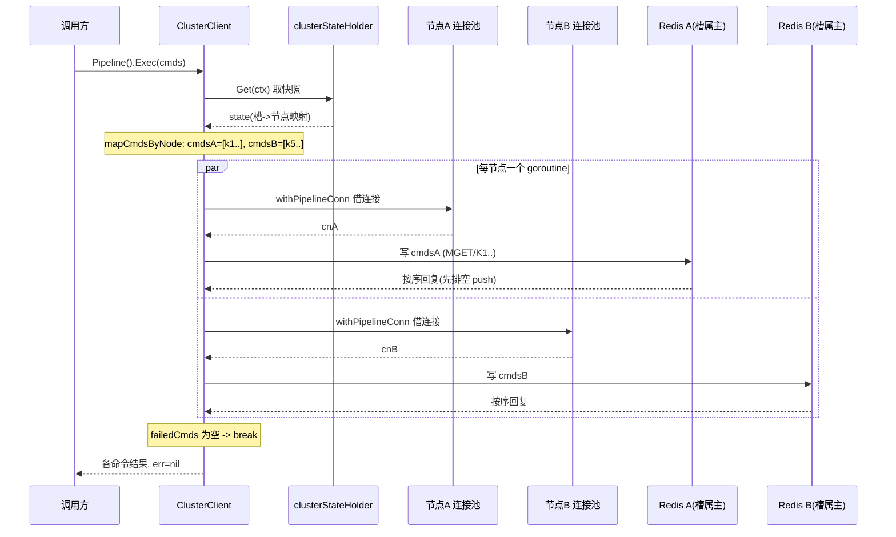
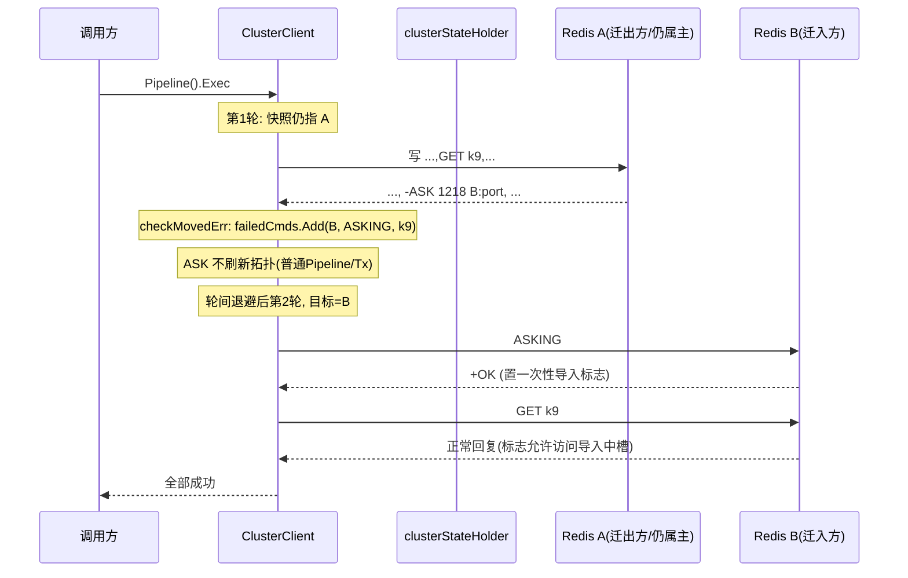

# Redis Cluster 路由与流水线重定向生命周期复盘

> 适用对象：go-redis（模块路径 `github.com/redis/go-redis/v9`，Go 1.24+）。
> 用途：线上 **Cluster 扩缩容期间少量流水线（Pipeline）请求延迟升高** 的故障复盘与边界评审。
> 本文从单命令与 Pipeline 的公开入口一路追踪到槽位计算、集群状态快照、节点选择、按节点拆分、连接借用、异构回复按序读取、MOVED/ASK 重定向与重试边界，并对照普通 Pipeline、TxPipeline、自动流水线（AutoPipeline）的差异。

## 0. 证据分级约定（务必先读）

为避免把注释当事实，本文每条结论都标注证据等级：

- **【源码保证】**：可由当前仓库代码直接推出，附 `文件:行号`。行号对应当前工作区快照，重构后可能漂移，请以函数名为准。
- **【测试佐证】**：有具名回归测试覆盖；标注了本次是否实际运行及结果（见文末「测试运行记录」）。
- **【待确认推断】**：由代码行为推断、但在当前环境（无 Docker / 无真实集群）无法端到端验证的部分，需要线上指标或集成环境进一步确认。

核心源码文件：

| 文件 | 职责 |
| --- | --- |
| `osscluster.go` | 集群客户端：`process`（单命令）、`processPipeline`、`processTxPipeline`、`mapCmdsByNode`、`checkMovedErr`、节点选择、`clusterStateHolder` 拓扑快照 |
| `osscluster_router.go` | 单命令的多槽/多节点路由策略（`ReqAllNodes/AllShards/MultiShard`） |
| `redis.go` | 单节点基类：`withPipelineConn`、`generalProcessPipeline`、连接借还 |
| `pipeline.go` / `tx.go` | Pipeline 公开入口、`wrapMultiExec`（MULTI/EXEC 包裹） |
| `autopipeline.go` | 自动流水线（阻塞面 `AutoPipeline` / 延迟面 `AsyncAutoPipeline`） |
| `error.go` | `shouldRetry`、`isBadConn`、`isMovedError`、`isRedisError`、`isContextError` |
| `command.go` | `setCmdsErr`、`cmdsFirstErr`、`cmdsContainNoRetry` |
| `internal/hashtag/hashtag.go` | hash tag 提取与 `Slot`（CRC16） |
| `internal/routing/policy.go` | 命令路由/聚合策略（`RequestPolicy`/`ResponsePolicy`） |

---

## 1. 公开入口与调用链总览

`NewClusterClient` 把三个执行函数注册进 Hook 链：`process`（单命令）、`processPipeline`（普通流水线）、`processTxPipeline`（事务流水线）。【源码保证】`osscluster.go:1222-1228`

### 1.1 单命令

```
Client.Get/Set/... (cmdable)
  -> ClusterClient.Process -> hooksMixin(ProcessHook 链)
  -> ClusterClient.process                       osscluster.go:1298
       slot = cmdSlot(cmd, -1)                    osscluster.go:2892 / 2922
       for attempt := 0 .. MaxRedirects:
           node = cmdNode / cmdNodeWithShardPicker osscluster.go:2934 / 2953
           ask?  [ASKING, cmd] 子流水线 : routeAndRun / node.Client.Process
           分类错误：READONLY / LOADING / MOVED / ASK / shouldRetry
```

带多键路由策略的命令（如 `MGET`/`KEYS` 类，`ReqMultiShard/AllNodes/AllShards`）走 `routeAndRun` 分派：`osscluster_router.go:31`，默认单键落 `executeDefault`（`osscluster_router.go:62`），多槽命令在 `executeMultiShard` 里 **按键分组到不同槽并发执行后聚合**（`osscluster_router.go:113` 起，`hashtag.Slot` 分组见 `:135`）。

### 1.2 普通 Pipeline

```
pipe := Client.Pipeline() / Client.Pipelined(fn)
pipe.Process(cmd)... 仅入队                      pipeline.go:84
pipe.Exec(ctx)                                   pipeline.go:104
  -> c.exec = ClusterClient.processPipeline      osscluster.go:1788
       mapCmdsByNode  (快照 + 按节点分组)          osscluster.go:1854
       for attempt := 0 .. MaxRedirects:
           每个节点一个 goroutine: processPipelineNode   osscluster.go:1956
             withProcessPipelineHook(节点级 Hook)
               withPipelineConn(借连接)           redis.go:1217
                 processPipelineNodeConn(写+读)   osscluster.go:2015
           wg.Wait；failedCmds 非空则 cmdsMap=failedCmds 进入下一轮
```

### 1.3 TxPipeline

```
Client.TxPipeline() / TxPipelined(fn)
  exec 内先 wrapMultiExec：[MULTI, ...cmds, EXEC]  tx.go:199
  -> processTxPipelineHook -> processTxPipeline   osscluster.go:2251
       去掉 MULTI/EXEC 外壳，按“有键命令”算槽
       跨槽 -> ErrCrossSlot；无键 -> 随机槽         osscluster.go:2280-2293
       node = state.slotMasterNode(slot)          （固定主节点，不走副本）
       for attempt := 0 .. MaxRedirects:
           outcome = processTxPipelineNode(...)   osscluster.go:2396
             线上报文： [ASKING?] MULTI cmds... EXEC
           按 outcome.kind 决策：Success/Moved/Ask/TryAgain/Conn/Fatal
```

### 1.4 自动流水线（AutoPipeline）

```
Client.AutoPipeline()   (阻塞面：调用方等待自己的命令结果)
Client.AsyncAutoPipeline() (延迟面：Submit 立即返回 AutoFuture)
  -> AutoPipeliner 后台 flusher 聚批 -> dispatchCmds
       splitRetryRuns 按 NoRetry 策略拆 run 保序    autopipeline.go:2223
       集群面最终也落到 ClusterClient.processPipeline（节点级拆分/重定向复用同一套）
```

集群场景下自动流水线的每条 **节点子批** 都经过 `pipelineReadCmds`（`osscluster.go:2073`）这条与普通 Pipeline 共用的读循环，因此重定向、push 排空、NoRetry 判定行为一致。【源码保证】`osscluster.go:2086-2088` 注释明确指出「autopipeliner routes all cluster traffic through it」。

---

## 2. 槽位计算

- 槽位 = `CRC16(key) mod 16384`；若 key 含 hash tag `{...}`，只对花括号内内容计算。【源码保证】`internal/hashtag/hashtag.go` 的 `Slot` / `keyHashTag`。
- 集群侧入口 `cmdSlot(cmd, preferredSlot)`（`osscluster.go:2892`）→ `cmdSlotWithPos`（`:2914`）→ 包级 `cmdSlot`（`:2922`）：
  - 通过 `cmdFirstKeyPosWithInfo` 定位首个键位（命令元信息来自 `cmdsInfoCache`）；
  - 取第一个键 `cmd.stringArg(pos)` 计算 `hashtag.Slot`；
  - **无键命令**（`pos == 0`）返回 `-1`，作为「交给 ShardPicker / 任意节点」的信号（`:2927-2928`）。
- **槽位缓存**：自然路径（`preferredSlot == -1`）会把槽位缓存在命令对象上，供自动流水线分片路由与 `mapCmdsByNode` 共享一次计算；**重试强制改路由时不写缓存也不读缓存**（`:2893-2907`）。【源码保证】
- 特例：`CLUSTER GETKEYSINSLOT/COUNTKEYSINSLOT` 直接用参数里的槽位（`:2916`）。

---

## 3. 集群状态快照与节点选择

### 3.1 不可变快照 `clusterState`

- `clusterStateHolder`（`osscluster.go:1086`）持有 `state atomic.Value`，快照一旦生成即不可变；路由全程读快照，刷新在后台替换整个指针。
- `Get(ctx)`（`:1146`）：
  - 快照为 `nil`（首次）→ **同步** `Reload(ctx)`（`:1149`）；
  - 否则返回当前快照；若距 `createdAt` 超过 `ClusterStateReloadInterval`（默认 60s，`osscluster.go:208-209`），**非阻塞** 触发一次 `LazyReload()`，但本次仍返回旧快照（`:1153-1156`）。

### 3.2 主节点 / 只读副本选择

- `cmdNode`（`:2934`）：`ReadOnly` 选项开启 **且** 命令在命令表中标记为只读（`cmdInfo.ReadOnly`）→ `slotReadOnlyNode`；否则 `state.slotMasterNode(slot)`。
- `slotReadOnlyNode`（`:2983`）按配置选择副本策略：`RouteByLatency`（最近）→ `RouteRandomly`（随机）→ `ShardPicker` → 默认 `slotSlaveNode`（同槽副本轮询）。
- 无键只读命令 + `ShardPicker`：在 `Masters+Slaves`（只读）或 `Masters`（写）里按 `ShardPicker.Next(n)` 挑片（`mapCmdsByNode` 内 `:1883-1895` / `:1929-1934`）。【源码保证】
- 节点健康：`clusterNode.MarkAsFailing()`（`:572`）把节点标记为异常，后续解析会绕开（重试时 `node=nil` 触发重新选节点）。

---

## 4. 拓扑懒加载如何合并并发刷新

`clusterStateHolder.LazyReload()`（`osscluster.go:1111-1144`）：

- 用 `reloading` 这个 `atomic.Uint32` 做 **CAS(0→1)** 抢闸：
  - 抢不到（已有刷新在跑）→ 只把 `reloadPending` 置 1 并返回（`:1113-1116`）。**N 个并发请求只会有 1 个真正刷新**。
- 抢到的 goroutine 循环：`Reload(context.Background())` → 清 `reloadPending` → `Sleep(200ms)` 冷却 → 若冷却期间又有人置了 `reloadPending` 就再刷一次，否则清 `reloading` 退出（`:1118-1143`）。
- 刷新出错：清两个标志位直接返回（`:1121-1125`），下一次 `LazyReload` 会重新尝试。

**合并语义**：并发刷新 = 1 次进行中的刷新 + 冷却窗口内至多 1 次尾随刷新；扩缩容时大量命令同时收到重定向，不会引发 N 次 `CLUSTER SLOTS/SHARDS` 风暴。【源码保证】
【测试佐证】`TestLazyReloadQueueBehavior`（`osscluster_lazy_reload_test.go`）的 7 个子用例覆盖单次、并发去重、冷却期挂起、多次挂起折叠、冷却后补刷、刷新出错、级联 SMIGRATED。本次运行 **PASS**（见文末）。

> 维护通知（maintnotifications）的 `SMIGRATED` 回调也是调用 `c.state.LazyReload()`（`osscluster.go:1237-1245`），与 MOVED/ASK 走同一合并通道。

---

## 5. 普通 Pipeline 生命周期：拆分 → 借连接 → 写 → 按序读 → 只重排失败命令

### 5.1 按节点拆分（映射阶段）

`mapCmdsByNode`（`osscluster.go:1854`）：

1. `state := c.state.Get(ctx)` 取快照（`:1855`）。
2. 全只读批（`ReadOnly` 且 `cmdsAreReadOnly`）走副本选择，否则走主节点（`:1860` 与 `:1907` 两个分支）。
3. 对每条命令算槽、选节点，`cmdsMap.Add(node, cmd)` 聚合到 `map[*clusterNode][]Cmder`（`cmdsMap` 定义 `:3078`，`Add` `:3087`，带锁）。
4. **All-or-nothing 预检**：若命令策略 `!CanBeUsedInPipeline()`（`ReqAllNodes/AllShards/MultiShard`），整批在 **派发前** 直接失败（`:1866-1879`、`:1912-1925`），保证用户 `Pipeline()` 要么整体派发、要么一条都不执行。

### 5.2 并发派发与连接借用

- `processPipeline`（`:1788`）每轮对 `cmdsMap` 中 **每个节点起一个 goroutine** 调 `processPipelineNode`，`wg.Wait()` 等全部回来（`:1825-1833`）。**不同节点并发，同一节点内命令严格有序。**
- `processPipelineNode`（`:1956`）：
  - `registerBatchExecutors(cmds)` 注册为延迟面批次的执行者，避免节点级 Hook（如 redisotel）在 `next()` 前 peek 结果时死锁（`:1965-1966`）。
  - 过 **节点级** `withProcessPipelineHook`（`:1973`）；`executed` 标志防止 Hook 不调 `next()` 却谎报成功（`:1972`、`:1994-2003`）。
  - `node.Client.withPipelineConn(...)` 借连接：优先节点的 **专用 pipeline 池**（`PipelinePoolSize` 等配置），未配置则回退主连接池（`:1981`，`redis.go:1217`）。
- **连接归还由回调返回的 error 决定**（`redis.go:1164` 注释「Shared by releaseConn and withPipelineConn」）：Redis 错误（回复已完整消费）连接可复用；传输错误 / 尚有未读回复 → 连接判废关闭。

### 5.3 写入与按序读取异构回复

`processPipelineNodeConn`（`:2015`）：

- `cn.WithWriter` 下先写 HIMPORT 注入命令，再 `writeCmds(wr, cmds)` 把该节点整批写出（`:2023-2030`）。
- `cn.WithReader` 下进入 `pipelineReadCmds`（`:2073`），**严格按下标顺序** 逐条 `cmd.readReply(rd)` + `cmd.SetErr(err)`（`:2092-2093`）。
- **每条回复前先排空 RESP3 push 帧**（`:2089` `processPendingPushNotificationWithReader`）：否则一条 push（如维护通知 MOVING）会被当成某条命令的回复，导致后续回复整体错位一条。【源码保证】`:2082-2091`。这是集群流水线读循环里唯一「push 盲」曾经存在、现已修复的点。
- 回复是异构的：状态/整数/bulk/数组/错误行都由各命令自己的 `readReply` 解析，顺序只由写入顺序决定。

### 5.4 只重排需要再次执行的命令

- **MOVED/ASK**：`checkMovedErr`（`:2125`）命中后 **只把当前这一条命令**（ASK 时再加一条 `ASKING`）放进 `failedCmds`，然后 `continue` 继续读后续回复（`:2099-2101`）。
- **命令级 Redis 错误**（如 `WRONGTYPE`、参数错误）：`SetErr` 留在该命令上，读循环继续；不进 `failedCmds`，连接保持干净可复用（`:2107` 的 `!isRedisError(err)` 分支不触发）。
- 一轮结束后 `cmdsMap = failedCmds`（`:1837`），下一轮只重派发失败子集；`len(failedCmds.m)==0` 即 `break`（`:1834-1836`）。

> **关键边界（传输错误 vs Redis 错误）**：读循环中若出现 **非 Redis 错误**（连接重置/EOF/超时，`:2107`），后续回复已无法从该连接读取，代码会把 **该节点整批 `cmds`** 重新 `mapCmdsByNode` 入 `failedCmds`（`:2108-2110`），并用 `setCmdsErr(cmds[i+1:], err)` 标记未读尾部（`:2111`）。此时 **已经读到成功回复的前 i 条命令也会随整批在下一轮重发** —— 普通 Pipeline 在「写出之后、读回复途中断连」是 **至少一次（at-least-once）** 语义，非幂等写（`INCR/APPEND`）可能重复生效。这与 TxPipeline 形成对照（见 §7.2）。【源码保证】`:2107-2113`。
> 【待确认推断】线上「少量流水线延迟升高」更可能来自重定向/重试的额外轮次与退避，而非重复执行本身；但扩缩容窗口内若确有非幂等写落在迁移槽且发生读侧断连，需排查是否有重复计数，建议用幂等脚本或 `SET` 带版本核对。

---

## 6. MOVED 与 ASK 的差异（重点）

两者都由 `isMovedError(err)` 解析出 `(moved, ask, addr)`（`error.go:230`，识别 `MOVED <slot> <addr>` / `ASK <slot> <addr>`，支持 IP 与主机名，且经 `errors.As` 穿透 Hook 包装）。差异在 **是否刷新拓扑、目标节点、是否前置 ASKING** 三点。

| 维度 | MOVED（永久迁移完成） | ASK（临时迁移中） |
| --- | --- | --- |
| 含义 | 槽已归属新主，旧拓扑过期 | 槽正在迁入目标，本次临时改道 |
| 刷新拓扑 | **是**，触发 `LazyReload()` | 普通 Pipeline / TxPipeline **不刷新**；单命令路径也会调 `LazyReload`（见下） |
| 本次目标 | 直接用重定向给出的 `addr`（权威地址） | 同样直接用 `addr`，但 **不依赖快照** |
| 前置命令 | 无 | **必须先发 `ASKING`**，否则目标节点对「正在导入但尚未归属」的槽拒绝执行 |
| 后续 | 快照更新后路由自然落到新主 | 迁移完成前每次都可能收到 ASK；ASKING 是一次性会话标志 |

### 6.1 三条路径的具体实现

- **单命令** `process`（`osscluster.go:1359-1381`）：`moved||ask` 时都调 `c.state.LazyReload()`（`:1361`），再 `node = nodes.GetOrCreate(addr)`（`:1376`）。下一轮若 `ask==true`，用一个子流水线发 `[ASKING, cmd]`（`:1325-1330`）；MOVED 则直接 `routeAndRun` 到新节点。
  - 注意：单命令路径对 ASK **也** 触发了 `LazyReload`（`:1361` 在 `moved||ask` 公共分支内）。此时服务端可能仍报告旧属主，刷新结果偏早但无害；真正让本次成功的是直接用 `addr` + `ASKING`。【源码保证】
  - MOVED/ASK **不退避**，立即重试（`:1307` `if attempt>0 && !moved && !ask` 才 Sleep）。
- **普通 Pipeline** `checkMovedErr`（`:2138-2147`）：
  - MOVED：`c.state.LazyReload()` + `failedCmds.Add(node, cmd)`（**只重排该命令，无 ASKING**）。
  - ASK：`failedCmds.Add(node, NewCmd("asking"), cmd)`（**重排 ASKING+该命令，不刷新拓扑**）。
- **TxPipeline** `processTxPipeline`（`:2319-2335`）：
  - `txRetryMoved`：`redirected=true; asking=false; LazyReload(); node=GetOrCreate(addr)`。
  - `txRetryAsk`：`redirected=true; asking=true; node=GetOrCreate(addr)`（**不刷新**）。
  - 报文组装 `processTxPipelineNode`（`:2399-2403`）：ASK 时 `ASKING` 放在 **MULTI 之前**，保证标志覆盖整个事务。

> **为什么成功的同批命令不会被重复执行（重定向/Redis 错误路径）**：每条回复都被独立消费并 `SetErr`；`checkMovedErr` 只把 **收到重定向的那一条** 加入 `failedCmds`，其余成功命令既不在 `failedCmds` 里、下一轮也不会被重写。【源码保证】`:2095-2101`、`:2138-2147`。
> 唯一例外仍是 §5.4 的 **读侧传输错误**：那时无法知道服务端到底执行了哪些，只能整节点批重排（at-least-once）。

---

## 7. 三种流水线对照

### 7.1 对照表

| 保证维度 | 普通 Pipeline | TxPipeline | 自动流水线 AutoPipeline |
| --- | --- | --- | --- |
| 槽位约束 | 可跨槽，按节点自动拆分 | **不允许跨槽**：有键命令落不同槽即 `ErrCrossSlot`；无键命令用随机槽（`:2280-2293`） | 复用集群拆分；非 pipelineable 策略命令在 **submit 预检** 拒绝，避免污染合并批（`:1870-1873`） |
| 原子性 | 无事务边界，命令各自生效 | MULTI/EXEC 原子执行；读侧断连判 **fatal** 不重发（避免 INCR/APPEND 双发，`:2588-2595`） | 无事务边界；按 run 派发 |
| 并发/顺序 | 节点间并发、节点内有序；返回结果按入队顺序 | 单节点（槽属主）串行；MULTI..EXEC 顺序固定 | 阻塞面单有序批流；延迟面 `NumShards>1` 必须 `Unordered:true`（`autopipeline.go:796`） |
| 读副本 | 全只读批可走副本 | **固定主节点**（`slotMasterNode`，`:2295`） | 同普通 Pipeline |
| Hook | `ProcessPipelineHook`；节点级 Hook peek 有防死锁注册（`:1965`） | 同左（`processTxPipelineNode` `:2409`） | 同样过 Hook 链；Hook 短路成功会被采纳（`:2000` 注释）；panic 转 per-cmd 错误（`recoverDispatchPanic` `:2260`） |
| MOVED | 刷新拓扑 + 重排该命令 | 直接跟 `addr`，刷新拓扑，整事务重发 | 复用 `pipelineReadCmds`，行为同普通 Pipeline |
| ASK | 重排 ASKING+该命令，不刷新 | ASKING 置 MULTI 前，整事务重发，不刷新 | 同普通 Pipeline |
| 重试预算 | `MaxRedirects` 轮；**轮间恒退避**（含纯重定向，`:1811-1820`） | `MaxRedirects` 轮；**重定向轮不退避**（`:2306` `!redirected` 才 Sleep） | 复用集群轮次；NoRetry 拆 run |
| 关闭 | `Close` 关节点客户端 | 同左 | `autopipelinerClosed` 阻止关闭后复活（`:1190`）；关闭排空在途，阻塞命令/无超时可能拖住关闭（`autopipeline.go:1715-1720`） |

> **延迟相关的非对称点（对复盘最直接）**：普通集群 Pipeline 在 **每一轮之间无条件 `Sleep(retryBackoff)`**（`osscluster.go:1811-1820`），没有单命令（`:1307`）和 TxPipeline（`:2306`）那种「重定向立即跟随、不退避」的判断。扩缩容时一批里只要有一条命令触发 MOVED/ASK，整批就要多付一轮 **退避 + 重新借连接 + 重发** 的代价（默认退避 `MinRetryBackoff`≈8ms 起、指数增长）。【源码保证】
> 【待确认推断】这很可能是「少量流水线请求延迟升高」的主因之一：重定向本身处理是即时的，但普通 Pipeline 的第二轮被退避拖慢；建议线上核对 P99 增量是否与 `MinRetryBackoff` 量级吻合，或考虑让纯重定向轮也跳过退避（需提 issue/PR 验证，不在本次改动范围）。

### 7.2 TxPipeline 为何对「写后断连」更保守

`txReadFatal`（`:2593`）：MULTI..EXEC 已写出后，若在读到 EXEC 结果前发生 IO 错误，服务端 **可能已提交事务**，重试会让非幂等命令双发，因此判 `txFatal` 并丢弃连接（`unreadReplies:true`）。设置阶段（ASKING/MULTI 回复）失败则事务体不会执行（EXEC 会 EXECABORT），可安全重试 → `txPreQueueErrorOutcome`（`:2603`）。EXEC 回复本身的错误由 `classifyExecError`（`:2614`）分类为 Moved/Ask/TryAgain/ClusterDown/ExecAbort。

---

## 8. 故障与重试决策表

下表「重排范围」针对普通集群 Pipeline（`processPipeline`）；单命令/Tx 的差异在备注列。`shouldRetry` 见 `error.go:84`，`isBadConn` 见 `:188`，`isRedisError` 见 `:177`，`isContextError` 见 `:59`。

| 故障/回复 | 刷新拓扑 | 目标 | ASKING | 重排范围（普通Pipeline） | 退避 | 连接处理 | NoRetry 影响 | 调用方最终看到 |
| --- | --- | --- | --- | --- | --- | --- | --- | --- |
| 正常回复 | 否 | 原节点 | 否 | 不重排 | — | 复用 | 无 | 各命令正常结果 |
| **MOVED** | 是 `LazyReload` | 重定向 `addr` | 否 | **仅该命令** | 单命令/Tx 不退避；普通Pipeline 轮间退避 | 回复读尽，复用 | 不影响（重定向不受 NoRetry 限制） | 成功（跟随新主）；耗尽则返回 MOVED 错误 |
| **ASK** | 普通Pipeline/Tx 否；单命令是 | 重定向 `addr` | **是**（Pipeline: 该命令前；Tx: MULTI 前） | **ASKING+该命令**（Tx 整事务） | 同上 | 复用 | 不影响 | 成功（临时改道）；耗尽返回 ASK 错误 |
| READONLY（写打到副本） | 是（单命令 `:1345`） | 重选主节点 | 否 | 单命令 `node=nil` 重选；Pipeline 走传输/重试分类 | 退避 | `isBadConn` 对 READONLY 判真关闭（`:205`） | — | 重试后成功；`READONLY` 属可重试（`shouldRetry:128`） |
| LOADING / MASTERDOWN / TRYAGAIN / CLUSTERDOWN / NOREPLICAS / maxclients | LOADING 副本会 MarkAsFailing 换节点（`:1352`） | 同节点/换节点 | 否 | 可重试错误进重试 | 退避 | Redis 错误连接复用；Tx 的 TRYAGAIN→同节点新连接 | `cmdsContainNoRetry` 为真则不重排 | 重试成功；耗尽见对应错误 |
| **传输错误（读侧，EOF/reset）** | 否（间接 MarkAsFailing） | `mapCmdsByNode` 重选 | 否 | **整节点子批重排（at-least-once）** `:2108` | 退避 | `isBadConn` 真 → 判废关闭 | **含 NoRetry 则整批不重试** | 重试成功或返回该 IO 错误；已成功命令可能被重发 |
| **写错误（partial write）** | 否 | 重排 | 否 | 整节点子批重排 `:2034` | 退避 | `isBadConn` 真关闭 | 含 NoRetry 不重试 | 同上 |
| 连接池超时 `ErrPoolTimeout` | 否 | 重排 | 否 | 可重试（`shouldRetry:108`） | 退避 | 获取失败 `!entered` 时 MarkAsFailing 并重映射（`:1985-1991`） | 含 NoRetry 不重试 | 重试或池超时错误 |
| 拨号错误 `net.OpError{Op:"dial"}` | 否 | 重排 | 否 | 可重试（`shouldRetry:98`，即便包在 DeadlineExceeded 里） | 退避 | 连接未建立，无污染 | 含 NoRetry 不重试 | 重试或拨号错误 |
| **context.Canceled / DeadlineExceeded** | 否 | 不重试 | 否 | **不重排**；`setCmdsErr` 标记未决命令 | Sleep 被 ctx 打断直接返回（`:1812-1819`） | `isBadConn` 真 → 判废（`:194`） | — | 返回 `context.Canceled/DeadlineExceeded`；**拨号 OpError 例外仍可重试** |
| 命令级 Redis 错误（WRONGTYPE/arity/EXECABORT 等） | 否 | 原节点 | 否 | **不重排**，错误留在该命令 | 无 | 回复读尽，复用 | 无 | 该命令返回具体错误，其余命令照常 |
| 批次含 **NoRetry** 命令（如 RawWriteToCmd） | — | — | — | 传输类失败时 **整批不重试**（`cmdsContainNoRetry` `command.go:276`） | — | — | 直接决定不重试 | 已写部分结果保留，未决命令得到当前错误，防止部分写被重复 |
| 节点级 Hook 不调 next（短路） | 否 | — | — | 不重映射（重试会重跑同一 Hook） | — | — | — | Hook 返回 err 则整批该错误；返回 nil 视为 Hook 已自行处理成功（`:1994-2012`） |
| 重试 / 重定向耗尽（`>MaxRedirects`） | — | — | — | 退出循环 | — | — | — | 返回 `lastErr`；`setCmdsErr` 只填尚无错误的命令，**服务端回复优先保留**（`command.go:254-261`）；Pipeline 返回 `cmdsFirstErr`（第一条错误） |

补充：

- `MaxRedirects` 归一化（`osscluster.go:212-218`）：`-1 → 0`（单次尝试，完全不跟随重定向），`0 → 3`（默认，循环 `attempt := 0; attempt <= MaxRedirects` 即最多 4 次尝试）。
- 单命令重试的节点策略（`:1383-1393`）：第 1 次重试 **同节点**（`attempt==0` continue），第 2 次起 `MarkAsFailing` + `node=nil` **换节点**。
- **旧状态下命令仍可能成功**：MOVED/ASK 都直接用重定向里的权威 `addr`，不等后台快照刷新；所以快照暂时陈旧不会让命令失败，只是第一轮可能打错节点。
- **节点失效**：`MarkAsFailing` 后重试改选其他节点；若快照里无可用节点 → `errClusterNoNodes`（如 `:1885`、`osscluster_router.go:76`）。

---

## 9. 时序图

### 9.1 正常 Pipeline（跨两节点）



### 9.2 MOVED（某条命令槽已迁移到 B）

```mermaid
sequenceDiagram
    participant U as 调用方
    participant C as ClusterClient
    participant H as clusterStateHolder
    participant RA as Redis A(旧属主)
    participant RB as Redis B(新属主)

    U->>C: Pipeline().Exec
    Note over C: 第1轮: 按旧快照把 k9 发到 A
    C->>RA: 写 ...,GET k9,...
    RA-->>C: ..., -MOVED 1218 B:port, ...(其余正常回复)
    Note over C: checkMovedErr: 仅 k9 入 failedCmds
    C->>H: LazyReload() (合并并发刷新)
    H-->>RA: 后台 CLUSTER SLOTS/SHARDS
    RA-->>H: 新拓扑(槽1218->B)
    Note over C: 其余命令成功,不重发; wg.Wait 后 failedCmds 非空
    Note over C: 普通Pipeline: 轮间 Sleep(retryBackoff) 后退避等待
    Note over C: 第2轮: cmdsMap=failedCmds, 节点=B
    C->>RB: GET k9 (无 ASKING)
    RB-->>C: 正常回复
    C-->>U: 全部成功(第1轮成功命令保持原结果)
```

### 9.3 ASK（槽正在迁入 B，尚未完成）



---

## 10. 关键不变量 → 源码入口 → 回归测试映射

| # | 不变量 | 源码入口（保证） | 回归测试（佐证） |
| --- | --- | --- | --- |
| 1 | 槽位=CRC16(hash tag) mod 16384；无键命令 slot=-1 | `internal/hashtag/hashtag.go`；`osscluster.go:2922` | hashtag 包内测试 |
| 2 | 路由读不可变快照；只读命令+ReadOnly 才走副本 | `osscluster.go:1146`、`:2934`、`:2983` | 集群 Ginkgo 副本用例（需 Docker） |
| 3 | Pipeline 按节点分组、节点间并发节点内有序 | `mapCmdsByNode :1854`；fan-out `:1825-1833` | Ginkgo「pipeline support」（需 Docker） |
| 4 | 回复按写入顺序逐条消费；每条前排空 RESP3 push 防错位 | `pipelineReadCmds :2073-2113`，push 排空 `:2089` | 集群 push/维护通知用例（需 Docker） |
| 5 | 重定向只重排受影响命令（+ASKING）；成功命令在重定向/Redis 错误路径不重发 | `checkMovedErr :2125-2150` | Ginkgo「follow redirects for GET/SET」「MOVED redirect for TxPipeline」（需 Docker） |
| 6 | MOVED 刷新拓扑不发 ASKING；ASK 前置 ASKING（Tx 在 MULTI 前） | `:1360-1381`、`:2138-2147`、`:2319-2335`、`:2399-2403` | Ginkgo「preserves ASKING when retrying a conn failure on the ASK target」（需 Docker，`:1154` MaxRedirects=2） |
| 7 | 读侧传输错误：普通 Pipeline 整节点批 at-least-once 重排；Tx 同类判 fatal 防双发 | `:2107-2113`；`txReadFatal :2593`；设置阶段失败 `txPreQueueErrorOutcome :2603` | Ginkgo ASK 连接失败重试用例（需 Docker） |
| 8 | 命令级 Redis 错误逐条 SetErr、不重排、连接复用 | `:2092-2113`；`isBadConn :203-217`（Redis 错误默认不判废） | `TestShouldRetryWithTypedErrors`（本次 PASS） |
| 9 | 上下文取消/超时不重试，连接判废；拨号 OpError 例外 | `shouldRetry :103`、`:98`；`isBadConn :194` | `TestPipelineContextCanceledNotRetried`、`TestDialConn_ContextCancelStopsFurtherRetries`、`TestDialTimeoutShouldRetry`、`TestContextErrorWrapping`（本次均 PASS） |
| 10 | 批次含 NoRetry 命令则整批不重试；自动流水线按 NoRetry 边界拆 run 保序 | `cmdsContainNoRetry command.go:276`；`:2034/:2108`；`splitRetryRuns autopipeline.go:2223` | `TestNoRetryRunsIsolatePolicyAndPreserveOrder`（本次 PASS） |
| 11 | 并发 LazyReload 合并为 1 次 + 冷却后至多 1 次尾随 | `LazyReload :1111-1144` | `TestLazyReloadQueueBehavior`（本次 PASS，7 子用例） |
| 12 | Hook 包装后的 MOVED/ASK 仍能被 errors.As 识别 | `isMovedError :230`；`proto.IsMovedError` | `TestMovedAndAskErrorsWithHookWrapping`、`TestMovedAndAskErrorAddressExtraction`（本次 PASS） |
| 13 | 节点级 Hook peek 结果不死锁；Hook 短路不谎报成功 | `registerBatchExecutors :1965`；`executed` 守卫 `:1972/:1994-2012` | `TestClusterNodeHookResultPeekNoDeadlock`（**本次 SKIP**：无 Docker 集群） |
| 14 | MaxRedirects 归一化(-1→0,0→3)；耗尽返回 lastErr 且 per-cmd 服务端回复优先 | `:212-218`；`setCmdsErr command.go:254-261`；返回 `cmdsFirstErr :263` | Ginkgo MaxRedirects=-1/0 用例（需 Docker，`:957/:1084/:2102`） |
| 15 | TxPipeline 跨槽拒绝、无键随机槽 | `processTxPipeline :2280-2293`；`hashtag.RandomSlot` | Ginkgo TxPipeline cross-slot 用例（需 Docker） |
| 16 | 延迟面 AutoPipeline NumShards>1 必须 Unordered；分片数与槽数解耦 | `newAutoPipeliner :796`；`splitRetryRuns :2223` | `TestAutoPipelineNumShardsValidation`、`TestClusterAutoPipelineOptionsShardDefault`、`TestAutoPipelineShardCountDecoupled`（本次 PASS） |
| 17 | 可重试错误分类（LOADING/READONLY/CLUSTERDOWN/TRYAGAIN/MASTERDOWN/maxclients/NOREPLICAS） | `shouldRetry error.go:84-175` | `TestShouldRetryWithTypedErrors`、`TestBackwardCompatibilityWithStringChecks`（本次 PASS） |

---

## 11. 复盘中最可能的延迟来源（结论与建议）

- **【源码保证】** 普通集群 Pipeline 在重定向/重试 **每一轮之间无条件退避**（`osscluster.go:1811-1820`），而单命令（`:1307`）与 TxPipeline（`:2306`）对纯重定向是立即跟随、不退避。扩缩容时一条命中迁移槽的命令会让整个节点子批多付出「退避 + 重新借连接 + 重发」。
- **【源码保证】** 第一轮可能打到旧属主（快照 60s 懒刷新或尚未应用后台刷新），靠 MOVED/ASK 里的权威 `addr` 改道；ASK 还要多一条 `ASKING` 往返（在同一连接内，不额外 RTT，但 TxPipeline 下 ASKING+MULTI+EXEC 顺序固定）。
- **【源码保证】** 并发重定向不会引发拓扑刷新风暴（LazyReload 合并）。
- **【待确认推断】** 建议线上：① 比对扩缩容窗口 Pipeline P99 增量与 `MinRetryBackoff`（默认 8ms 起）量级；② 统计 `MOVED/ASK` 指标回调（`:1364-1373` 已埋点）频次；③ 对迁移槽上的非幂等写核查是否存在读侧断连导致的 at-least-once 重复（§5.4），必要时改 Lua 脚本幂等化；④ 评估是否让普通 Pipeline 的纯重定向轮也跳过退避（属潜在优化，需单独 issue/PR 与压测，不在本文档改动范围）。

---

## 12. 测试运行记录（本次实际执行）

环境：Windows，`go version go1.26.1 windows/amd64`，工作区为仓库根模块 `github.com/redis/go-redis/v9`。
**Docker daemon 未运行、集群端口 16600/16602 不可达**，因此依赖真实集群的 Ginkgo E2E 与节点 Hook 测试无法在本环境执行（已如实记录为 SKIP/未运行）；下列为不依赖 Redis 的纯单元测试，全部 **PASS**。

| 命令 | 覆盖不变量 | 结果 |
| --- | --- | --- |
| `go test -run TestLazyReloadQueueBehavior -count=1 -v .` | #11 懒加载并发合并 | **PASS**（8.388s）；7 子用例 SingleReload / ConcurrentReloadsDeduplication / PendingReloadDuringCooldown / MultiplePendingReloadsCollapsed / ReloadAfterCooldownPeriod / ErrorDuringReload / CascadingSMIGRATEDScenario 全 PASS |
| `go test -run "TestMovedAndAskErrorsWithHookWrapping\|TestShouldRetryWithTypedErrors\|TestBackwardCompatibilityWithStringChecks\|TestErrorWrappingInHookScenario\|TestDialTimeoutShouldRetry" -count=1 -v .` | #8 #9 #12 #17 错误分类/重试/Hook 包装穿透 | **PASS**（5.052s）；含 LOADING/READONLY/CLUSTERDOWN/TRYAGAIN/MASTERDOWN/maxclients/NOREPLICAS 重试判定、拨号 OpError 包裹在 DeadlineExceeded 内仍重试、纯 context 错误不重试 |
| `go test -run TestMovedAndAskErrorAddressExtraction -count=1 -v ./internal/proto/` | #12 MOVED/ASK 地址解析（IP/主机名） | **PASS**（1.553s），4 子用例全 PASS |
| `go test -run "TestNoRetryRunsIsolatePolicyAndPreserveOrder\|TestClusterAutoPipelineOptionsShardDefault\|TestAutoPipelineNumShardsValidation\|TestAutoPipelineShardCountDecoupled" -count=1 -v .` | #10 #16 NoRetry 拆 run 保序、自动流水线分片校验 | **PASS**（3.527s） |
| `go test -run "TestPipelineContextCanceledNotRetried\|TestContextErrorWrapping" -count=1 -v .` | #9 流水线/上下文取消不重试 | **PASS**（5.848s） |
| `go test -run "TestDialConn_ContextCancelStopsFurtherRetries\|TestDialConn_AppliesDialTimeoutPerAttemptViaContext" -count=1 -v ./internal/pool/` | #9 拨号层取消停止重试、每次尝试拨号超时 | **PASS**（2.972s） |
| `go test -run TestClusterNodeHookResultPeekNoDeadlock -count=1 -v .` | #13 节点级 Hook peek 不死锁 | **SKIP**：`no cluster: dial tcp :16602: connectex: No connection could be made ...`（无 Docker 集群） |

**未在本环境运行（需 Docker 测试栈）**，复现方式：

```sh
make docker.start          # 启动 standalone/cluster/sentinel profile
# 重定向跟随（GET/SET/MOVED/TxPipeline/ASK-连接失败重试）
go test -run TestGinkgoSuite . -ginkgo.focus="redirect|MOVED|ASK|pipeline|TxPipeline"
# 节点级 Hook 不死锁
go test -run TestClusterNodeHookResultPeekNoDeadlock -count=1 -v .
make docker.stop
```

对应 Ginkgo 用例位于 `osscluster_test.go`：「should follow redirects for GET/SET」「should follow MOVED redirect for TxPipeline」「preserves ASKING when retrying a conn failure on the ASK target」（后者 `MaxRedirects=2`，覆盖 source-ASK→target 连接失败→target 成功的路径）。

> 说明：本次任务仅新增本文档，未修改任何 Go 源码、测试或既有文档。
