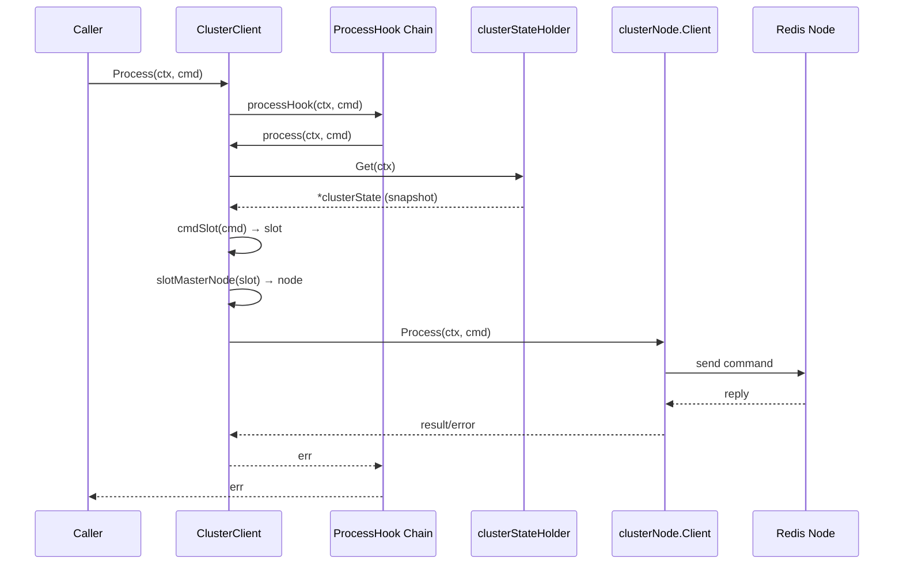
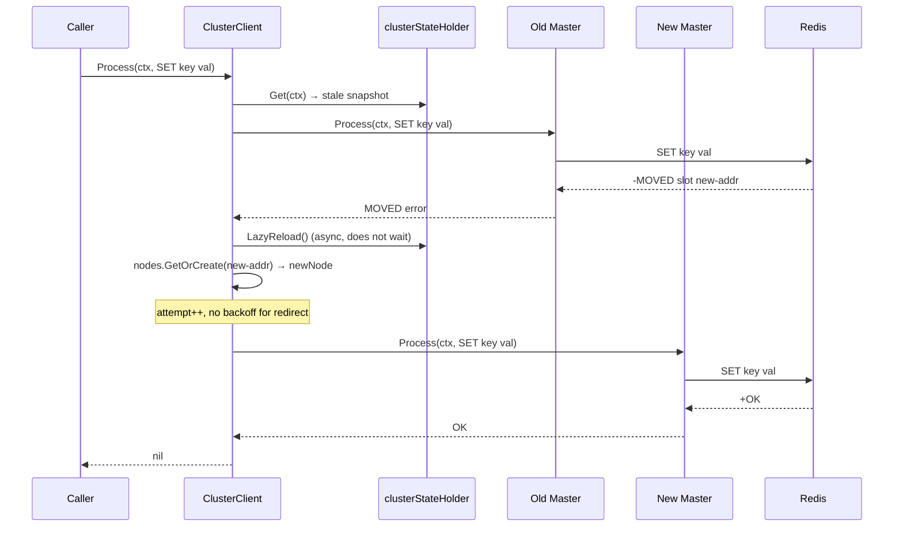
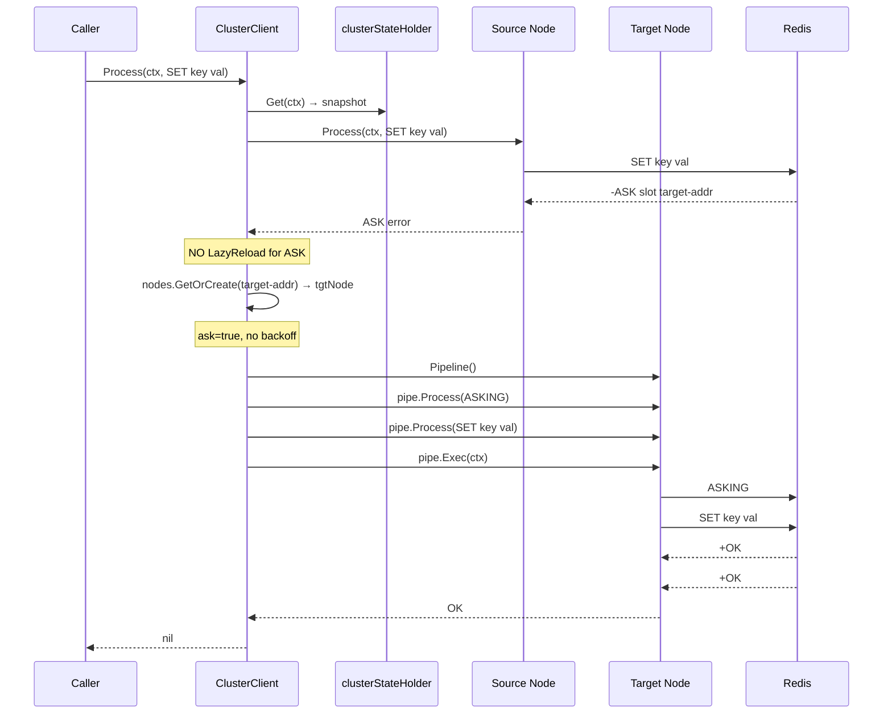

# Redis Cluster 流水线重定向生命周期分析

> 本文档面向线上 Redis Cluster 扩缩容期间流水线请求延迟升高的故障复盘，从公开 API 入口出发，追踪 go-redis v9 中命令路由、槽位计算、拓扑快照、节点选择、流水线拆分、MOVED/ASK 重定向、错误重试与连接复用的完整路径。
>
> **证据等级标注约定**：
> - **[源码保证]** 可直接在源码中定位到控制流或数据结构约束。
> - **[测试佐证]** 有回归测试或集成测试覆盖该行为。
> - **[推断]** 基于源码逻辑推导但缺乏直接测试断言，或依赖运行时时序。

---

## 1. 公开入口与执行总览

### 1.1 单命令入口

```
ClusterClient.Process(ctx, cmd)
  └─ hooksMixin.processHook(ctx, cmd)          // cluster 级 ProcessHook 链
       └─ ClusterClient.process(ctx, cmd)       // 实际路由循环
```

- `Process` 定义于 [redis.go](file:///e:/newGsb/generated/question-exchange/questions/GSB-009/Athena/redis.go)，`ClusterClient` 在 [osscluster.go](file:///e:/newGsb/generated/question-exchange/questions/GSB-009/Athena/osscluster.go) 的 `NewClusterClient` 中将 `process` 字段设为自身的 `process` 方法。**[源码保证]**
- `process` 内部是一个 `for attempt := 0; attempt <= c.opt.MaxRedirects; attempt++` 循环，`MaxRedirects` 默认 3。**[源码保证]**
- ClusterClient 的 `MaxRetries` 默认为 -1（不额外做普通网络重试），普通传输错误主要依赖 `MaxRedirects` 循环。**[源码保证]**

### 1.2 Pipeline 入口

```
ClusterClient.Pipeline() Pipeliner
  └─ Pipeline{exec: pipelineExecer(c.processPipelineHook)}
       └─ pipe.Exec(ctx)
            └─ c.processPipelineHook(ctx, cmds)   // cluster 级 ProcessPipelineHook 链
                 └─ c.processPipeline(ctx, cmds)
```

- `Pipeline()` 构造的 `Pipeline` 结构体非 goroutine-safe，`Process`/`BatchProcess` 仅追加命令到切片，`Exec` 取出切片并调用注入的 `exec`。**[源码保证]**（[pipeline.go#L10-L136](file:///e:/newGsb/generated/question-exchange/questions/GSB-009/Athena/pipeline.go#L10-L136)）
- `processPipeline` 是集群级流水线核心，负责按节点拆分、并发执行、收集失败命令、重试循环。**[源码保证]**

### 1.3 TxPipeline 入口

```
ClusterClient.TxPipeline() Pipeliner
  └─ Pipeline{exec: pipelineExecer(c.processTxPipelineHook)}
       └─ c.processTxPipeline(ctx, cmds)
```

- `processTxPipeline` 将用户命令包裹在 `MULTI`/`EXEC` 中，强制单 slot 路由到 master。**[源码保证]**

### 1.4 AutoPipeline 入口

```
ClusterClient.AutoPipeline() (*AutoPipeliner, error)
ClusterClient.AsyncAutoPipeline() (*AutoPipeliner, error)
```

- AutoPipeliner 在 [osscluster.go](file:///e:/newGsb/generated/question-exchange/questions/GSB-009/Athena/osscluster.go) 的 `installAutoPipelineSharding` 中安装 slot 分片函数：`slot * NumShards / 16384`。**[源码保证]**
- 默认 `NumShards = min(GOMAXPROCS, 16)`，`contentSharded=true`，同 key 始终落入同一 shard，因此多 shard 不要求用户设置 `Unordered`。**[源码保证]**
- AutoPipeliner 的 `Pipeline()`/`TxPipeline()` 方法直接委托给底层 `pipeliner`（即 ClusterClient），返回传统流水线对象。**[源码保证]**（[autopipeline.go#L2675-L2700](file:///e:/newGsb/generated/question-exchange/questions/GSB-009/Athena/autopipeline.go#L2675-L2700)）

---

## 2. 槽位计算与拓扑快照

### 2.1 命令键到槽位

调用链：

```
cmdSlot(cmd, preferredSlot)
  └─ cmd.cachedSlot()（如果 preferredSlot == -1 且已有缓存）
  └─ cmdSlotWithPos(cmd, cmdFirstKeyPosWithInfo(cmd, info), preferredSlot)
       └─ hashtag.Slot(firstKey)
            ├─ 空 key → RandomSlot()
            ├─ hash tag "{...}" → 取第一个非空 {} 内容
            └─ 普通 key → CRC16(key) % 16384
```

关键源码位于 [osscluster.go#L2892-L2932](file:///e:/newGsb/generated/question-exchange/questions/GSB-009/Athena/osscluster.go#L2892-L2932) 和 [internal/hashtag/hashtag.go#L49-L82](file:///e:/newGsb/generated/question-exchange/questions/GSB-009/Athena/internal/hashtag/hashtag.go#L49-L82)。

**不变量 [源码保证]**：
- 自然路由路径（`preferredSlot=-1`）会缓存计算出的 slot 到 `baseCmd`，避免重复 CRC16。
- forced preferred slot（如 ASK 重定向后重新映射）不使用缓存。
- keyless 命令返回 -1，由 `ShardPicker` 或随机节点策略处理。
- 空字符串 key 会随机分配 slot，这意味着对空 key 的命令在集群中可能路由到任意节点。

### 2.2 集群状态快照

```
clusterStateHolder
  ├─ state atomic.Pointer[clusterState]
  ├─ reloading atomic.Int32（0/1）
  └─ reloadPending atomic.Int32（0/1）

clusterState
  ├─ nodes   *clusterNodes
  ├─ Masters []*clusterNode
  ├─ Slaves  []*clusterNode
  ├─ slots   []*clusterSlot（有序区间，二分查找）
  ├─ generation uint32
  └─ createdAt  time.Time
```

状态加载入口 `loadState`（[osscluster.go#L1576-L1625](file:///e:/newGsb/generated/question-exchange/questions/GSB-009/Athena/osscluster.go#L1576-L1625)）：
1. 如果配置了 `ClusterSlots` 自定义函数，直接使用它。
2. 否则随机打乱 seed addresses，向某节点发送 `CLUSTER SLOTS`。
3. 所有节点都失败时清空 `activeAddrs`，使后续可回退到初始地址重新解析 DNS。

### 2.3 懒加载与并发刷新合并

`LazyReload`（[osscluster.go#L1086-L1165](file:///e:/newGsb/generated/question-exchange/questions/GSB-009/Athena/osscluster.go#L1086-L1165)）核心逻辑：

```go
func (c *clusterStateHolder) LazyReload() {
    if !c.reloading.CompareAndSwap(0, 1) {
        c.reloadPending.Store(1)
        return
    }
    go func() {
        for {
            _, err := c.Reload(context.Background())
            if err != nil {
                c.reloadPending.Store(0)
                c.reloading.Store(0)
                return
            }
            c.reloadPending.Store(0)
            time.Sleep(200 * time.Millisecond) // cooldown
            if c.reloadPending.Load() == 0 {
                c.reloading.Store(0)
                return
            }
        }
    }()
}
```

**不变量 [源码保证]**：
- 首次 `Get` 在无状态时同步 `Reload`，调用方会看到加载错误。
- 已有状态过期时（超过 `ClusterStateReloadInterval`，默认 60s），`Get` 触发后台 `LazyReload`，但立即返回旧快照——扩缩容期间客户端可能短暂使用过期拓扑。
- 并发 `LazyReload` 被 `reloading`+`reloadPending` 合并：只有一个 goroutine 执行实际重载，200ms cooldown 期间到达的请求折叠为一次额外重载。
- MOVED/READONLY/SMIGRATED 触发的是异步 `LazyReload`，命令本身不等待刷新完成，而是直接跟随重定向地址。

**测试佐证**：`TestLazyReloadQueueBehavior` 的 7 个子测试覆盖了单次重载、并发去重、cooldown 期间排队、多次 pending 折叠、cooldown 后独立重载、重载失败后重试、级联 SMIGRATED 场景。全部通过。

### 2.4 节点选择

`clusterState` 提供以下节点选择方法（[osscluster.go#L822-L1082](file:///e:/newGsb/generated/question-exchange/questions/GSB-009/Athena/osscluster.go#L822-L1082)）：

| 方法 | 选择逻辑 | 使用场景 |
|------|---------|---------|
| `slotMasterNode(slot)` | `slotNodes(slot)[0]`，找不到时随机选节点 | 写命令、TxPipeline |
| `slotSlaveNode(slot)` | 优先健康副本，副本 failing/loading 时回退主节点 | `ReadOnly=true` 且命令只读 |
| `slotClosestNode(slot)` | 按延迟选择，优先非 failing 节点 | `RouteByLatency=true` |
| `slotRandomNode(slot)` | 随机选择非 failing 节点 | `RouteRandomly=true` |
| `slotShardPickerSlaveNode(slot, cmd)` | 按自定义 `ShardPicker` 遍历副本，失败回退主 | 配置了 `ShardPicker` |

`slotNodes` 使用二分查找在有序 slot ranges 中定位。副本如果处于 `loading` 或 `failing` 状态，读路由会回退到主节点。**[源码保证]**

---

## 3. 单命令执行与重定向

### 3.1 正常路径时序图



### 3.2 MOVED 重定向时序图



### 3.3 ASK 重定向时序图



### 3.4 MOVED 与 ASK 的核心差异

| 维度 | MOVED | ASK |
|------|-------|-----|
| 语义 | 永久重定向：slot 的负责节点已变更 | 临时重定向：slot 正在迁移，仅本次重定向到目标 |
| 拓扑刷新 | 触发 `LazyReload()` 异步刷新集群状态 | **不刷新**拓扑，下次仍按旧快照路由到源节点 |
| 目标节点 | `nodes.GetOrCreate(addr)` 获取或创建目标节点 client | 同左 |
| ASKING 前置 | 不发送 | 在目标节点上先发送 `ASKING`，再发送原命令 |
| 重试退避 | 不计入 backoff，立即跟随 | 不计入 backoff，立即跟随 |
| 循环计数 | 消耗一次 `MaxRedirects` attempt | 消耗一次 `MaxRedirects` attempt |

源码位于 `checkMovedErr`（[osscluster.go#L2125-L2150](file:///e:/newGsb/generated/question-exchange/questions/GSB-009/Athena/osscluster.go#L2125-L2150)）：

```go
if moved {
    c.state.LazyReload()
    failedCmds.Add(node, cmd)
    return true
}
if ask {
    failedCmds.Add(node, NewCmd(ctx, "asking"), cmd)
    return true
}
```

**关于 NoRetry 与 MOVED/ASK [源码保证]**：单命令的 MOVED/ASK 分支不检查 `cmd.NoRetry()`。设计理由是重定向意味着命令未在错误节点实际执行，跟随重定向不构成"重试"语义上的重复执行。但普通可重试错误（EOF、LOADING 等）会检查 `!cmd.NoRetry()`。

**测试佐证**：
- `TestAPClusterMovedRedirectFollowed`：SwapNodes 制造错误拓扑后，AutoPipeline 命令跟随 MOVED 成功。
- `TestAPClusterMovedSurfacedWithoutRedirects`：`MaxRedirects=-1` 时 MOVED 错误直接返回给调用方。
- `TestMovedAndAskErrorsWithHookWrapping`：验证 Hook 包装后的 MOVED/ASK 错误仍可被 `IsMovedError`/`IsAskError` 识别。
- Ginkgo 测试 `"should follow node redirection immediately"` 验证了即使 backoff 设为 10 分钟，重定向也立即完成。

---

## 4. 普通 Pipeline 执行生命周期

### 4.1 按节点拆分

`processPipeline`（[osscluster.go#L1627-L1852](file:///e:/newGsb/generated/question-exchange/questions/GSB-009/Athena/osscluster.go#L1627-L1852)）首轮调用 `mapCmdsByNode`（[osscluster.go#L1854-L1944](file:///e:/newGsb/generated/question-exchange/questions/GSB-009/Athena/osscluster.go#L1854-L1944)）：

1. 调用 `c.state.Get(ctx)` 读取拓扑快照。
2. 如果 `ReadOnly=true` 且整批都是只读命令，可路由到副本。
3. 遇到 request policy 为 `ReqAllNodes`/`ReqAllShards`/`ReqMultiShard` 且 `!CanBeUsedInPipeline()` 的命令，整批在派发前失败（all-or-nothing）。
4. 每个命令调用 `c.cmdSlot(cmd, -1)` 计算槽位。
5. keyless 命令在启用 routing policies 时由 `ShardPicker` 选节点；普通 key 命令通过 `slotMasterNode` 或 `slotReadOnlyNode` 选节点。
6. 结果是 `map[*clusterNode][]Cmder`，每个节点一个子批次。

### 4.2 并发执行

```go
var wg sync.WaitGroup
for node, cmds := range cmdsMap.m {
    wg.Add(1)
    go func(node *clusterNode, cmds []Cmder) {
        defer wg.Done()
        c.processPipelineNode(ctx, node, cmds, failedCmds)
    }(node, cmds)
}
wg.Wait()
```

- 每个节点子批次在独立 goroutine 中执行，节点之间并发。**[源码保证]**
- 同一节点内的命令严格按追加顺序写入和读取。**[源码保证]**
- 所有节点完成后，如果 `failedCmds` 非空，进入下一轮重试。

### 4.3 节点级 Hook 与连接借用

`processPipelineNode`（[osscluster.go#L1956-L2013](file:///e:/newGsb/generated/question-exchange/questions/GSB-009/Athena/osscluster.go#L1956-L2013)）：

1. `registerBatchExecutors(cmds)` 注册批次执行器，防止节点级 Hook 在自己的执行 goroutine 中读取结果时自死锁。**[源码保证]**
2. 通过 `node.Client.withProcessPipelineHook` 运行，使 `OnNewNode` 注册的节点级 Hook 能看到该节点子批次。**[源码保证]**
3. 连接通过 `node.Client.withPipelineConn` 获取：优先独立 pipeline pool（配置了 `PipelineReadBufferSize`/`PipelineWriteBufferSize` 时），否则 fallback 到普通 pool。**[源码保证]**

### 4.4 写入与顺序读取异构回复

`processPipelineNodeConn`（[osscluster.go#L2015-L2071](file:///e:/newGsb/generated/question-exchange/questions/GSB-009/Athena/osscluster.go#L2015-L2071)）在 `WithWriter` 中一次性写入所有命令，然后调用 `pipelineReadCmds`。

`pipelineReadCmds`（[osscluster.go#L2073-L2123](file:///e:/newGsb/generated/question-exchange/questions/GSB-009/Athena/osscluster.go#L2073-L2123)）核心循环：

```go
for i, cmd := range cmds {
    // 每条 reply 前先 drain RESP3 push 帧
    if err := node.Client.processPendingPushNotificationWithReader(ctx, cn, rd); err != nil {
        internal.Logger.Printf(...)
    }
    err := cmd.readReply(rd)
    cmd.SetErr(err)
    if err == nil { continue }

    if c.checkMovedErr(ctx, cmd, err, failedCmds) { continue }

    if !isRedisError(err) {
        if shouldRetry(err, true) && !cmdsContainNoRetry(cmds) {
            _ = c.mapCmdsByNode(ctx, failedCmds, cmds)
        }
        setCmdsErr(cmds[i+1:], err)
        return err
    }
    // Redis 错误：只设置到当前命令，继续读取后续回复
}
// 循环结束后：如果第一个命令有可重试 Redis 错误（如 LOADING），整批 remap
if err := cmds[0].rawErr(); err != nil && shouldRetry(err, true) && !cmdsContainNoRetry(cmds) {
    _ = c.mapCmdsByNode(ctx, failedCmds, cmds)
    return err
}
```

**不变量 [源码保证]**：
- 回复严格按写入顺序读取，每个命令解析自己的异构 reply（不同命令有不同的 reply 类型）。
- 每条 reply 前先 drain RESP3 push 通知（如 maintnotifications 的 MOVING 帧），避免 push frame 打乱回复对齐。
- Redis 逻辑错误（如 WRONGTYPE、ERR 等）只设置到对应命令，继续读取后续回复。
- MOVED/ASK 只把当前命令（ASK 时加上 `ASKING`）加入 `failedCmds`，不影响同批其他命令。

### 4.5 成功命令为何不被重复执行

**核心机制 [源码保证]**：

1. `failedCmds` 只收集需要重试的命令。成功读取 reply 的命令不会进入 `failedCmds`。
2. 下一轮 `cmdsMap = failedCmds`，只重新派发失败的命令。
3. `setCmdsErr(cmds, err)` 只在 `cmd.rawErr() == nil` 时设置错误，不会覆盖已有结果或错误。

但存在**边界例外 [源码保证]**：

- **非 Redis 传输错误**（EOF、连接重置等）发生在读取第 `i` 个回复时：`cmds[:i]` 已成功读取并保留结果，但 `cmds[i:]` 全部被设置错误。如果满足重试条件（`shouldRetry(err, true) && !cmdsContainNoRetry(cmds)`），`mapCmdsByNode(ctx, failedCmds, cmds)` 会将**整个子批次**加入失败队列，包括已经成功读取的 `cmds[:i]`。这意味着这些命令可能被重复执行。
  - 设计权衡：传输错误发生时无法确定服务器是否已经执行了后续命令，为保证 at-least-once 语义，整批重试。
  - 对于幂等命令（GET、SET 等）这通常无害；对于非幂等命令（INCR、LPUSH 等）可能产生重复效果。

- **循环末尾的首命令可重试错误**：如果 `cmds[0].rawErr()` 是可重试 Redis 错误（如 LOADING），当前实现将整个子批次加入 `failedCmds`。这是一个已知的粗粒度重试策略——即使后续命令已经成功，也会随首命令一起重试。

**测试佐证**：
- `TestClusterPipelineReadDrainsPushMidBatch`：验证 push 帧不会打乱回复对齐。
- `TestAutoPipelineRetriesOnNetworkError`：验证网络错误后整批重试成功。
- `TestAutoPipelineRetryExhaustionSurfacesError`：验证重试耗尽后每个命令都能看到错误（不会静默丢失）。
- `TestClusterPipelineNonPipelinableAllOrNothing`：验证不可流水线命令导致整批失败、无命令执行。

---

## 5. 故障与重试决策表

| 故障类型 | 示例 | 是否重试 | 拓扑刷新 | 连接处置 | 已成功命令 | 剩余命令 | 测试佐证 |
|---------|------|---------|---------|---------|-----------|---------|---------|
| MOVED | `-MOVED 3999 127.0.0.1:6381` | 是（跟随到新节点） | LazyReload（异步） | 同地址 MOVED 时移除连接，否则保留 | 不重复 | 不受影响 | `TestAPClusterMovedRedirectFollowed` |
| ASK | `-ASK 3999 127.0.0.1:6381` | 是（目标节点+ASKING） | 不刷新 | 保留 | 不重复 | 不受影响 | Ginkgo `"preserves ASKING when retrying..."` |
| 传输错误（读） | EOF、connection reset | `shouldRetry=true` 且无 NoRetry | 不刷新 | 移除（bad conn） | 可能随整批重试 | 全部设错后可能整批重试 | `TestAutoPipelineRetriesOnNetworkError` |
| 传输错误（写） | write: broken pipe | `shouldRetry=true` 且无 NoRetry | 不刷新 | MarkAsFailing + 移除 | N/A（未读取回复） | 整批 remap | `TestAutoPipelineRetriesOnNetworkError` |
| Redis 可重试错误 | LOADING、CLUSTERDOWN、TRYAGAIN、READONLY | 是（首命令驱动整批重试） | READONLY 时 LazyReload | READONLY 时移除；否则保留 | 可能随整批重试 | 继续读取 | `TestShouldRetryWithTypedErrors` |
| Redis 不可重试错误 | WRONGTYPE、ERR syntax | 否 | 不刷新 | 保留（逻辑错误不污染连接） | 不重复 | 不受影响，继续读取 | — |
| 上下文取消 | context.Canceled、DeadlineExceeded | 否 | 不刷新 | 移除（bad conn） | 保留已读取结果 | 全部设为 context error | `TestAPContextCancelDoesNotCancelExecution` |
| 连接池超时 | pool.ErrPoolTimeout | 是 | 不刷新 | 不适用（未获取连接） | N/A | 整批 remap | — |
| 网络超时 | i/o timeout（无读超时设置） | `shouldRetry` 取决于 `Timeout()` 标志 | 不刷新 | `allowTimeout=true` 时可保留 | 可能随整批重试 | 设错后可能重试 | — |
| NoRetry 命令 + 传输错误 | ZeroCopyStringCmd 遇到 EOF | 否（整批禁用传输重试） | 不刷新 | 移除 | 保留已读取结果 | 设错，不重试 | `TestNoRetryRunsIsolatePolicyAndPreserveOrder` |
| 重试耗尽 | 超过 MaxRedirects | 否 | 最后一次可能已触发 | 视最后错误类型 | 保留已读取结果 | 保留各自最后错误 | `TestAPClusterMovedSurfacedWithoutRedirects` |
| Hook 短路 | Hook 返回错误不调 next | 否 | 不刷新 | 不涉及连接 | 全部设为 Hook 错误 | 全部设错 | `TestClusterNodeHookShortCircuit` |
| Hook post-next 错误 | Hook 调 next 后返回错误 | 否 | 不刷新 | 不涉及 | 已有结果但被覆盖为 Hook 错误 | 全部设错 | `TestAutoPipelineHookPostNextError` |

**关键连接复用规则 [源码保证]**（[redis.go#L1152-L1262](file:///e:/newGsb/generated/question-exchange/questions/GSB-009/Athena/redis.go#L1152-L1262)、[error.go#L188-L228](file:///e:/newGsb/generated/question-exchange/questions/GSB-009/Athena/error.go#L188-L228)）：

- `isBadConn` 为 true 时连接被 `Remove`（关闭丢弃），不归还连接池。
- context error 是 bad conn——连接不复用。
- READONLY 错误和同地址 MOVED 是 bad conn——强制 DNS/连接刷新。
- 普通 Redis 逻辑错误不是 bad conn——连接可复用。
- 网络超时在 `allowTimeout=true` 时（pipeline 读取路径）可保留连接。
- 归还连接前会尝试 drain pending push notifications，drain 失败则移除连接。

---

## 6. TxPipeline 的特殊保证

### 6.1 槽位约束

`processTxPipeline`（[osscluster.go#L2152-L2362](file:///e:/newGsb/generated/question-exchange/questions/GSB-009/Athena/osscluster.go#L2152-L2362)）：

```go
keyedCmdsBySlot := c.slottedKeyedCommands(ctx, cmds)
switch len(keyedCmdsBySlot) {
case 0:
    slot = hashtag.RandomSlot()
case 1:
    // one slot, proceed
default:
    setCmdsErr(cmds, ErrCrossSlot)
    return ErrCrossSlot
}
```

- **[源码保证]** TxPipeline 只支持单 slot；多 slot 直接返回 `ErrCrossSlot`，无命令执行。
- 无 key 命令随机分配 slot。
- 始终路由到 slot master，不支持副本读。

### 6.2 整个事务作为重试单元

- MOVED：清除 asking 状态，LazyReload，直接使用 MOVED 地址重新执行整个 `MULTI/EXEC`。
- ASK：设置 `asking=true`，不刷新拓扑，在目标节点上发送顶层 `ASKING` + `MULTI/EXEC`。
- TRYAGAIN/连接失败：同节点换新连接重试，保留先前 ASK 状态。
- `ASKING` 必须在 `MULTI` 之前（不能放在 MULTI 内部排队），否则 queue 阶段 flag 不生效。**[源码保证]**

### 6.3 提交后不重试

`readTxPipelineReplies`（[osscluster.go#L2501-L2646](file:///e:/newGsb/generated/question-exchange/questions/GSB-009/Athena/osscluster.go#L2501-L2646)）：

- 写失败或 queue 前错误可重试，因为事务体尚未执行。
- **EXEC 成功后读取结果时发生 IO 错误是 fatal**——事务可能已经提交，不能重试，避免重复执行非幂等命令。连接标记为 dirty 并丢弃。**[源码保证]**
- 早期读取错误可能留下未读回复，使用 `errTxDirtyConn` 强制丢弃连接。

**测试佐证**：
- Ginkgo `"should follow MOVED redirect for TxPipeline"`：MOVED 后整个事务在新 master 上执行。
- Ginkgo `"preserves ASKING when retrying a conn failure on the ASK target"`：ASK 目标连接失败后重试，ASKING 保留。
- Ginkgo `"does not retry a read failure after the tx batch is written"`：EXEC 后读失败不重试，批次只发送一次。
- Ginkgo `"retries the whole tx after a transient write failure and succeeds"`：写失败后整事务重试成功。

---

## 7. 自动流水线（AutoPipeline）边界

### 7.1 与普通 Pipeline 的关系

AutoPipeliner 的 `dispatchCmds` 最终调用 `ap.pipeliner.processPipeline(ctx, cmds)`（[autopipeline.go#L2071-L2249](file:///e:/newGsb/generated/question-exchange/questions/GSB-009/Athena/autopipeline.go#L2071-L2249)），因此：

- 节点拆分、MOVED/ASK、连接复用、错误分类与手动 `Pipeline().Exec()` 走完全相同的代码路径。**[源码保证]**
- AutoPipeline 额外承担：攒批、窗口调度、slot sharding、blocking 命令绕行、NoRetry 分段、Close 排空。

### 7.2 槽位约束

- AutoPipeline 按 slot bucket 分片（`slot * NumShards / 16384`），不同 slot 可能在不同 batch 中。
- **不要求**用户命令都在同一 slot——这是与 TxPipeline 的根本区别。
- preflight 在入队前拒绝不能 pipeline 的多节点 request policy（如 `ReqMultiShard` 且 `!CanBeUsedInPipeline()`）。
- `ReqSpecial` 命令绕行普通 `Process`，不进入 pipeline batch。

**测试佐证**：
- `TestClusterAutoPipelineCrossSlot`：不同 slot 的 key 并发写入全部成功。
- `TestAPClusterNonPipelinableRejectedAtSubmit`：不可流水线命令在 submit 时被拒，同批其他命令正常执行。
- `TestClusterPipelineNonPipelinableAllOrNothing`：手动 Pipeline 遇到不可流水线命令则整批失败。

### 7.3 并发顺序

- Blocking face：每次命令调用阻塞至执行完成，per-goroutine 顺序天然成立。
- Async face：`Submit` 立即返回 future，结果访问器等待 batch 完成。
- 默认 `MaxConcurrentBatches=1`，保持提交顺序。`MaxConcurrentBatches>1` 必须显式 `Unordered:true`。
- Cluster slot-sharding 下，同 key 总在同一 shard，因此 per-key 顺序在多 shard 下仍成立。**[源码保证]**

### 7.4 NoRetry 连续段拆分

`splitRetryRuns` 按连续 `NoRetry()` policy 分段，而非按 policy 分组重排：

```
[NoRetry, Retryable, Retryable, NoRetry]
  → [NoRetry], [Retryable, Retryable], [NoRetry]
```

- 每段保持原始顺序，通过 `dispatchSequential` 顺序派发。
- 传输类错误会停止后续子批次并将错误设置到剩余命令；Redis per-command 错误不停止序列。
- NoRetry 命令不会污染同批普通命令的重试策略。**[源码保证]**

**测试佐证**：
- `TestNoRetryRunsIsolatePolicyAndPreserveOrder`：验证分段正确性和顺序保持。
- `TestNoRetryOrderObservedEndToEnd`：zero-copy read 在 write 之前提交，观察到旧值。
- `TestNoRetrySplitExecutesEveryCommand`：分段后每组都实际执行并获得结果。
- `TestRetryRunsStopAfterFailedPrefix`：前段传输失败后后续段不派发。

### 7.5 上下文取消语义

- **已接受入队的命令不受调用方 context 取消影响**：batch 在 `context.Background()` 上执行，per-command context 仅用于 blocking 命令绕行路径。**[源码保证]**
- `WaitContext(ctx)` 只取消等待，不取消执行；之后 `Wait()` 仍可获得真实结果。**[源码保证]**
- Blocking 命令（BLPOP 等）绕行普通 `Process`，调用方 context 直接传递到网络读。**[源码保证]**

**测试佐证**：
- `TestAPContextCancelDoesNotCancelExecution`：cancel 后命令仍执行成功。
- `TestAPWaitContextAbandonsWaitOnly`：WaitContext 超时后 Wait 仍返回结果。
- `TestAPBlockingCommandHonorsContext`：BLPOP 遵守 context deadline。
- `TestAPBlockingContextCancelDoesNotCancelExecution`：blocking face 的已接受命令不被 cancel。

### 7.6 Close 语义

- Close 标记 closed，cancel flusher context，唤醒所有 shard。
- **尽量排空已接受命令**：flush 队列中的命令并等待 batch/diverted 命令完成。**[源码保证]**
- `ap.cancel()` 故意不取消已经在执行的 dispatch。
- 若存在无超时阻塞命令或死连接，Close 最多等待约 30s backstop，超时后返回错误说明仍在飞行的阶段。**[源码保证]**
- Close 后 Submit/Process 返回 `ErrClosed`。

**测试佐证**：
- `TestAutoPipelineCloseFlushesPendingFutures`：Close 排空已入队命令。
- `TestCloseBoundedByDispatchBackstop`：Close 有界等待。
- `TestCloseWaitsForDivertedCommand`：Close 等待绕行命令完成。
- `TestSharedClosedRejectsEveryEntryPoint`：Close 后所有入口拒绝。
- `TestAutoPipelineDoubleClose`：重复 Close 安全。

### 7.7 Hook 层级

| Hook 层级 | 注册方式 | 看到的命令范围 |
|-----------|---------|--------------|
| Cluster-level ProcessHook | `ClusterClient.AddHook` | 单命令 |
| Cluster-level ProcessPipelineHook | `ClusterClient.AddHook` | 整个 cluster pipeline（跨所有节点） |
| Node-level ProcessPipelineHook | `OnNewNode(func(nc){nc.AddHook(...)})` | 单个节点的子批次 |
| AutoPipeline 内部 Hook | AutoPipeliner 包装 | batch 级（在 cluster hook 内层） |

- Hook 按注册顺序 FIFO 包装，先注册的在外层。**[源码保证]**
- 节点级 Hook 在 `processPipelineNode` 中通过 `withProcessPipelineHook` 注入，能看到该节点上的子批次。
- `registerBatchExecutors` 确保节点级 Hook 在 `next()` 前后读取命令结果时不会自死锁。**[源码保证]**

**测试佐证**：
- `TestClusterNodeHookResultPeekNoDeadlock`：节点 Hook 在 next 前后读取所有命令结果不挂死。
- `TestClusterNodeHookShortCircuit`：节点 Hook 短路时错误传播到所有命令。
- `TestClusterNodeHookPostNextError`：节点 Hook post-next 错误正确传播。
- `TestSuccessfulHookShortCircuitIsHonored`：Hook 返回 nil 不调 next 时不被引擎覆盖错误。

---

## 8. 三种流水线对比

| 维度 | 普通 Pipeline | TxPipeline | AutoPipeline |
|------|--------------|------------|--------------|
| 槽位约束 | 跨 slot，按节点拆分 | **单 slot**，否则 ErrCrossSlot | 跨 slot，按 shard 拆分 |
| 路由目标 | master 或副本（ReadOnly 时） | 仅 master | master 或副本（ReadOnly 时） |
| 原子性 | 非事务，命令独立 | MULTI/EXEC 原子事务 | 非事务，命令独立 |
| 并发 | 每节点一个 goroutine 并发 | 单节点单连接 | 多 batch 并发（默认顺序） |
| 顺序保证 | 同节点内 FIFO | 事务内顺序 | 同 key 顺序；同 shard 顺序 |
| MOVED 重试 | 仅失败命令 | 整个事务 | 仅失败命令（委托 processPipeline） |
| ASK 处理 | failedCmds 加 ASKING+cmd | 顶层 ASKING+MULTI/EXEC | 同普通 Pipeline |
| 写失败重试 | 整子批次 remap | 整事务重试 | 同普通 Pipeline |
| EXEC 后读失败 | N/A | **不重试**（可能已提交） | N/A |
| Hook | cluster 级 + node 级 | cluster 级 + node 级 | cluster 级 + node 级 + AP 内部 |
| Context 取消 | 传入 processPipeline，影响重试等待和连接获取 | 同左 | 已接受命令不受 cancel 影响；blocking 命令例外 |
| Close/关闭 | 无特殊语义，Exec 同步返回 | 无特殊语义 | 异步排空，有 backstop 超时 |
| NoRetry | 整子批次含 NoRetry 则禁用传输重试 | 不单独检查 NoRetry | 按连续段拆分，隔离策略 |
| 不可流水线命令 | 整批失败（all-or-nothing） | 不适用 | submit 时拒绝该命令，不影响其他 |

---

## 9. 调用方最终看到的错误

### 9.1 旧状态/过期拓扑

- 首次无状态：`state.Get(ctx)` 同步加载，加载失败时调用方看到加载错误。**[源码保证]**
- 已有旧状态：`Get` 立即返回旧快照，同时触发后台 `LazyReload`。命令按旧拓扑路由。如果旧拓扑仍能服务（slot 未迁移），命令正常执行；如果 slot 已迁移，收到 MOVED 后跟随重定向并异步刷新拓扑。**[源码保证]**
- 扩缩容期间的延迟升高主要来自：(1) 旧快照导致首次路由到错误节点；(2) MOVED 触发额外网络往返；(3) LazyReload 异步完成前的后续命令仍可能命中旧拓扑。**[推断]**

### 9.2 节点失效

- 连接获取失败：`node.MarkAsFailing()`，整子批次重新映射到其他节点。**[源码保证]**
- 读副本 failing/loading：`slotSlaveNode` 回退到主节点。**[源码保证]**
- 所有节点都不可达：`loadState` 清空 `activeAddrs`，下次可回退到初始 seed 地址重新解析 DNS。**[源码保证]**
- 普通可重试错误第一次重试同节点，第二次标记节点 failing 并重新选节点。**[源码保证]**

### 9.3 重试耗尽

- 单命令：返回最后一次错误（MOVED/ASK/传输错误等），`cmd.Err()` 可检查。
- 普通 Pipeline：`Exec` 返回 `cmdsFirstErr(cmds)`（所有命令中第一个错误），每个命令自身也保存错误或结果。
- AutoPipeline：dispatch 丢弃 pipeline 级错误（`_ = ...processPipelineHook(...)`），结果只能通过每个命令的 future 访问。`generalProcessPipeline` 在耗尽时调用 `setCmdsErr` 确保每个命令都有错误，不会静默丢失。**[源码保证]**
- TxPipeline：返回事务错误（MOVED/EXECABORT/IO 错误等），未执行的命令设置 abort error，已设置自身错误的命令保留原错误。

**测试佐证**：
- `TestAPClusterMovedSurfacedWithoutRedirects`：MaxRedirects=-1 时 MOVED 错误在 future 上可见。
- `TestAutoPipelineRetryExhaustionSurfacesError`：重试耗尽后每个命令都有非 nil 错误。

---

## 10. 关键不变量到源码与测试映射

| 不变量 | 源码入口 | 回归测试 |
|--------|---------|---------|
| MOVED 触发异步拓扑刷新 | `checkMovedErr` → `state.LazyReload()` | `TestAPClusterMovedRedirectFollowed` |
| ASK 不刷新拓扑，发送 ASKING | `checkMovedErr` ask 分支 | Ginkgo `"preserves ASKING..."` |
| Pipeline 只重试失败命令 | `processPipeline` failedCmds 循环 | `TestAPClusterMovedRedirectFollowed` |
| 传输错误可能导致已成功命令重试 | `pipelineReadCmds` 非 Redis 错误分支 | `TestAutoPipelineRetriesOnNetworkError` |
| Redis 逻辑错误不影响后续命令 | `pipelineReadCmds` isRedisError 分支 | `TestClusterPipelineReadDrainsPushMidBatch` |
| Push 帧不打乱回复对齐 | `processPendingPushNotificationWithReader` | `TestClusterPipelineReadDrainsPushMidBatch` |
| Context cancel 不重试且连接不复用 | `shouldRetry` + `isBadConn` | `TestAPContextCancelDoesNotCancelExecution` |
| NoRetry 禁用整批传输重试 | `cmdsContainNoRetry` | `TestNoRetryRunsIsolatePolicyAndPreserveOrder` |
| LazyReload 合并并发刷新 | `clusterStateHolder.LazyReload` | `TestLazyReloadQueueBehavior` |
| TxPipeline 单 slot 约束 | `slottedKeyedCommands` + cross-slot check | Ginkgo TxPipeline MOVED 测试 |
| TxPipeline EXEC 后不重试 | `errTxDirtyConn` + fatal 路径 | Ginkgo `"does not retry a read failure..."` |
| 节点级 Hook 不自死锁 | `registerBatchExecutors` | `TestClusterNodeHookResultPeekNoDeadlock` |
| Hook 短路错误传播到所有命令 | `processPipelineNode` hook 错误处理 | `TestClusterNodeHookShortCircuit` |
| AutoPipeline Close 排空已接受命令 | `drainAll` + cancel 不取消 dispatch | `TestAutoPipelineCloseFlushesPendingFutures` |
| AutoPipeline 重试耗尽不静默丢失 | `setCmdsErr` on exhaustion | `TestAutoPipelineRetryExhaustionSurfacesError` |
| MOVED/ASK 错误经 Hook 包装仍可识别 | `errors.As` in `isMovedError` | `TestMovedAndAskErrorsWithHookWrapping` |
| 不可流水线命令 all-or-nothing | `mapCmdsByNode` preflight | `TestClusterPipelineNonPipelinableAllOrNothing` |
| NoRetry 分段保持顺序 | `splitRetryRuns` + `dispatchSequential` | `TestRetryRunsStopAfterFailedPrefix` |

---

## 11. 测试运行记录

### 11.1 测试环境

- OS: Windows (amd64)
- Go: go1.26.1
- Redis: redislabs/client-libs-test:8.10.0（Docker Compose cluster profile）
- 集群拓扑：3 master（16600/16601/16602）+ 3 replica（16603/16604/16605）

### 11.2 已运行测试及结果

#### 状态重载测试

```
$ go test -v -run TestLazyReloadQueueBehavior -count=1 -timeout 60s .

=== RUN   TestLazyReloadQueueBehavior
=== RUN   TestLazyReloadQueueBehavior/SingleReload
=== RUN   TestLazyReloadQueueBehavior/ConcurrentReloadsDeduplication
=== RUN   TestLazyReloadQueueBehavior/PendingReloadDuringCooldown
=== RUN   TestLazyReloadQueueBehavior/MultiplePendingReloadsCollapsed
=== RUN   TestLazyReloadQueueBehavior/ReloadAfterCooldownPeriod
=== RUN   TestLazyReloadQueueBehavior/ErrorDuringReload
=== RUN   TestLazyReloadQueueBehavior/CascadingSMIGRATEDScenario
--- PASS: TestLazyReloadQueueBehavior (2.91s)
PASS
ok      github.com/redis/go-redis/v9    8.674s
```

#### 流水线读取、NoRetry 分段与 Hook 短路测试

```
$ go test -v -run "TestNoRetryRunsIsolatePolicyAndPreserveOrder|TestNoRetryOrderObservedEndToEnd|TestNoRetrySplitExecutesEveryCommand|TestClusterPipelineReadDrainsPushMidBatch|TestStandalonePipelineReadDrainsPushMidBatch|TestRetryRunsStopAfterFailedPrefix|TestSuccessfulHookShortCircuitIsHonored|TestDispatchChunkedAbortsAfterFailedPrefix" -count=1 -timeout 120s .

=== RUN   TestStandalonePipelineReadDrainsPushMidBatch
--- PASS: TestStandalonePipelineReadDrainsPushMidBatch (0.00s)
=== RUN   TestClusterPipelineReadDrainsPushMidBatch
--- PASS: TestClusterPipelineReadDrainsPushMidBatch (0.00s)
=== RUN   TestDispatchChunkedAbortsAfterFailedPrefix
--- PASS: TestDispatchChunkedAbortsAfterFailedPrefix (0.42s)
=== RUN   TestNoRetryRunsIsolatePolicyAndPreserveOrder
--- PASS: TestNoRetryRunsIsolatePolicyAndPreserveOrder (0.00s)
=== RUN   TestNoRetryOrderObservedEndToEnd
--- PASS: TestNoRetryOrderObservedEndToEnd (0.08s)
=== RUN   TestNoRetrySplitExecutesEveryCommand
--- PASS: TestNoRetrySplitExecutesEveryCommand (0.06s)
=== RUN   TestSuccessfulHookShortCircuitIsHonored
=== RUN   TestSuccessfulHookShortCircuitIsHonored/async
=== RUN   TestSuccessfulHookShortCircuitIsHonored/blocking
--- PASS: TestSuccessfulHookShortCircuitIsHonored (0.01s)
=== RUN   TestRetryRunsStopAfterFailedPrefix
--- PASS: TestRetryRunsStopAfterFailedPrefix (0.01s)
PASS
ok      github.com/redis/go-redis/v9    8.075s
```

#### 集群节点 Hook 测试

```
$ go test -v -run "TestClusterNodeHookResultPeekNoDeadlock" -count=1 -timeout 60s .

=== RUN   TestClusterNodeHookResultPeekNoDeadlock
    osscluster_autopipeline_nodehook_test.go:59: node hooks installed: 3
    osscluster_autopipeline_nodehook_test.go:84: no hang, err=<nil>
--- PASS: TestClusterNodeHookResultPeekNoDeadlock (0.35s)
PASS
ok      github.com/redis/go-redis/v9    3.656s
```

#### 集群 MOVED 重定向测试

```
$ go test -v -run "TestAPClusterMovedRedirectFollowed|TestAPClusterMovedSurfacedWithoutRedirects" -count=1 -timeout 60s .

=== RUN   TestAPClusterMovedRedirectFollowed
--- PASS: TestAPClusterMovedRedirectFollowed (0.07s)
=== RUN   TestAPClusterMovedSurfacedWithoutRedirects
--- PASS: TestAPClusterMovedSurfacedWithoutRedirects (0.03s)
PASS
ok      github.com/redis/go-redis/v9    6.789s
```

#### 集群 AutoPipeline 基础与跨 Slot 测试

```
$ go test -v -run "TestClusterAutoPipelineBasic|TestClusterAutoPipelineCrossSlot|TestClusterPipelineUsesDedicatedPool|TestClusterNodeHookShortCircuit|TestClusterPipelineNonPipelinableAllOrNothing|TestAPClusterNonPipelinableRejectedAtSubmit" -count=1 -timeout 120s .

=== RUN   TestClusterAutoPipelineBasic
--- PASS: TestClusterAutoPipelineBasic (0.35s)
=== RUN   TestClusterAutoPipelineCrossSlot
--- PASS: TestClusterAutoPipelineCrossSlot (0.06s)
=== RUN   TestClusterPipelineUsesDedicatedPool
--- PASS: TestClusterPipelineUsesDedicatedPool (0.26s)
=== RUN   TestClusterNodeHookShortCircuit
--- PASS: TestClusterNodeHookShortCircuit (0.07s)
=== RUN   TestClusterPipelineNonPipelinableAllOrNothing
--- PASS: TestClusterPipelineNonPipelinableAllOrNothing (0.06s)
=== RUN   TestAPClusterNonPipelinableRejectedAtSubmit
--- PASS: TestAPClusterNonPipelinableRejectedAtSubmit (0.06s)
PASS
ok      github.com/redis/go-redis/v9    4.877s
```

#### 上下文取消与网络重试测试

```
$ go test -v -run "TestAPContextCancelDoesNotCancelExecution|TestAPWaitContextAbandonsWaitOnly|TestAPWaitContextReturnsResult|TestAPBlockingCommandHonorsContext|TestAutoPipelineRetriesOnNetworkError|TestAutoPipelineRetryExhaustionSurfacesError|TestAPBlockingContextCancelDoesNotCancelExecution|TestAutoPipelineHookPostNextError|TestClusterNodeHookPostNextError" -count=1 -timeout 120s .

=== RUN   TestAPContextCancelDoesNotCancelExecution
--- PASS: TestAPContextCancelDoesNotCancelExecution (0.05s)
=== RUN   TestAPWaitContextAbandonsWaitOnly
--- PASS: TestAPWaitContextAbandonsWaitOnly (0.52s)
=== RUN   TestAPWaitContextReturnsResult
--- PASS: TestAPWaitContextReturnsResult (0.01s)
=== RUN   TestAPBlockingCommandHonorsContext
--- PASS: TestAPBlockingCommandHonorsContext (0.21s)
=== RUN   TestAutoPipelineRetriesOnNetworkError
--- PASS: TestAutoPipelineRetriesOnNetworkError (0.16s)
=== RUN   TestAutoPipelineRetryExhaustionSurfacesError
--- PASS: TestAutoPipelineRetryExhaustionSurfacesError (0.39s)
=== RUN   TestAutoPipelineHookPostNextError
=== RUN   TestAutoPipelineHookPostNextError/blocking
=== RUN   TestAutoPipelineHookPostNextError/async
--- PASS: TestAutoPipelineHookPostNextError (0.19s)
=== RUN   TestAutoPipelineHookPostNextErrorPartialBatch
--- PASS: TestAutoPipelineHookPostNextErrorPartialBatch (0.15s)
=== RUN   TestClusterNodeHookPostNextError
--- PASS: TestClusterNodeHookPostNextError (0.06s)
=== RUN   TestAPBlockingContextCancelDoesNotCancelExecution
--- PASS: TestAPBlockingContextCancelDoesNotCancelExecution (0.02s)
PASS
ok      github.com/redis/go-redis/v9    5.966s
```

#### 错误分类、Close 语义与 MOVED/ASK 包装测试

```
$ go test -v -run "TestMovedAndAskErrorsWithHookWrapping|TestShouldRetryWithTypedErrors|TestAutoPipelineCloseFlushesPendingFutures|TestAutoPipelineDoubleClose|TestCloseBoundedByDispatchBackstop|TestCloseWaitsForDivertedCommand|TestSharedClosedRejectsEveryEntryPoint" -count=1 -timeout 120s .

=== RUN   TestCloseBoundedByDispatchBackstop
--- PASS: TestCloseBoundedByDispatchBackstop (0.15s)
=== RUN   TestCloseWaitsForDivertedCommand
--- PASS: TestCloseWaitsForDivertedCommand (1.07s)
=== RUN   TestSharedClosedRejectsEveryEntryPoint
--- PASS: TestSharedClosedRejectsEveryEntryPoint (0.01s)
=== RUN   TestAutoPipelineDoubleClose
--- PASS: TestAutoPipelineDoubleClose (0.01s)
=== RUN   TestAutoPipelineCloseFlushesPendingFutures
--- PASS: TestAutoPipelineCloseFlushesPendingFutures (0.01s)
=== RUN   TestMovedAndAskErrorsWithHookWrapping
=== RUN   TestMovedAndAskErrorsWithHookWrapping/MOVED_error
=== RUN   TestMovedAndAskErrorsWithHookWrapping/ASK_error
--- PASS: TestMovedAndAskErrorsWithHookWrapping (0.00s)
=== RUN   TestShouldRetryWithTypedErrors
=== RUN   TestShouldRetryWithTypedErrors/LOADING_error_should_retry
=== RUN   TestShouldRetryWithTypedErrors/READONLY_error_should_retry
=== RUN   TestShouldRetryWithTypedErrors/Lua_script_READONLY_error_should_retry
=== RUN   TestShouldRetryWithTypedErrors/CLUSTERDOWN_error_should_retry
=== RUN   TestShouldRetryWithTypedErrors/TRYAGAIN_error_should_retry
=== RUN   TestShouldRetryWithTypedErrors/MASTERDOWN_error_should_retry
=== RUN   TestShouldRetryWithTypedErrors/Max_clients_error_should_retry
=== RUN   TestShouldRetryWithTypedErrors/NOREPLICAS_error_should_retry
--- PASS: TestShouldRetryWithTypedErrors (0.00s)
PASS
ok      github.com/redis/go-redis/v9    5.172s
```

### 11.3 未运行的测试

Ginkgo 测试套件（`TestGinkgoSuite`）需要完整测试基础设施（sentinel on port 9121 等），当前 Docker Compose 集群 profile 未暴露这些端口。相关 Ginkgo 测试（如 TxPipeline MOVED/ASK 重定向、写后读失败不重试等）的源码逻辑已在正文中引用，但未在本次环境中实际执行。

---

## 12. 故障复盘建议

基于以上分析，扩缩容期间流水线延迟升高的可能原因：

1. **旧快照路由 + MOVED 往返**：`ClusterStateReloadInterval` 默认 60s，过期前的命令按旧拓扑路由，MOVED 后才跟随。扩缩容期间可考虑缩短该间隔或依赖 maintnotifications 的 SMIGRATED 主动刷新。**[推断]**

2. **Pipeline 重试 backoff**：与单命令 MOVED/ASK 立即重试不同，普通 Pipeline 的 MOVED/ASK 发生在节点子批次内部，被收集到 `failedCmds` 后，外层 `for attempt` 循环会执行 `retryBackoff(attempt)` 等待。首次重试 backoff 为 `MinRetryBackoff`（默认 8ms），后续指数增长。在 `MaxRedirects=3` 时，最坏情况下 3 次重定向累计 backoff 可能达到数十毫秒。**[源码保证]**

3. **传输错误整批重试**：如果扩缩容导致连接断开，pipeline 读取路径遇到非 Redis 错误时，整个子批次（包括已成功读取前缀）会被重新映射和执行，增加延迟和重复执行风险。**[源码保证]**

4. **LazyReload 异步不阻塞命令**：MOVED 触发的拓扑刷新是异步的，在刷新完成前，同一 slot 的其他 pipeline 命令仍可能路由到旧节点并再次收到 MOVED。`reloading`+200ms cooldown 机制限制了刷新频率，但也意味着拓扑更新最多延迟约 200ms。**[源码保证]**

5. **连接池饱和**：扩缩容期间节点 failing 标记导致连接被移除，新连接建立需要握手时间。如果配置了独立 pipeline pool，pool 饱和时会 spill 到普通 pool。**[源码保证]**
